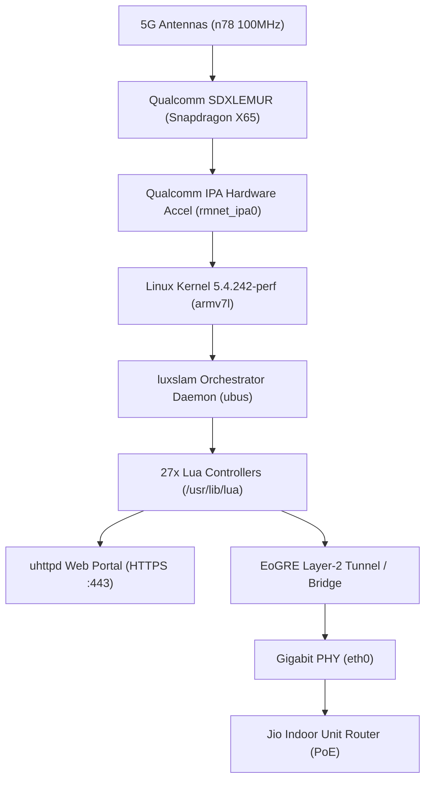

# Jio AirFiber 5G ODU (JODU52140) Reverse Engineering & Architecture

[-blue.svg)]()
[-green.svg)]()
[]()
[]()
[-purple.svg)]()

Complete reverse-engineering documentation, system architecture analysis, configuration backups, control plane scripts, and management CLI for the **Jio AirFiber 5G Outdoor Unit (JODU52140)**.

---

## 📑 Table of Contents
- [Hardware & Serial Connection](#-hardware--serial-connection)
- [System Architecture](#-system-architecture)
- [Repository Structure](#-repository-structure)
- [Quick Start: Python CLI](#-quick-start-python-cli)
- [Control Plane & Ubus API](#-control-plane--ubus-api)
- [Configuration Reference](#-configuration-reference)
- [Network Modes & EoGRE](#-network-modes--eogre)
- [License & Disclaimer](#-license--disclaimer)

---

## 🔌 Hardware & Serial Connection

The device motherboard exposes a debug UART serial header operating at **1.8V logic level**.

### Serial Parameters
* **Logic Level:** `1.8V TTL` *(Warning: 3.3V or 5.0V without level shifting will damage the SoC!)*
* **Baud Rate:** `115200`
* **Data Bits:** `8`
* **Parity:** `None`
* **Stop Bits:** `1`
* **Flow Control:** `None`

### Default Console Credentials
```text
login: root
Password: oelinux123
```

---

## 🏗️ System Architecture



### Specifications Summary
* **Device Model:** `JODU52140`
* **Product Name:** `Jio ODU`
* **ODM:** Luxshare Precision Industry Co., Ltd. (OUI: `7C:BF:77`)
* **SoC:** Qualcomm Technologies, Inc. `SDXLEMUR` (Snapdragon X65/X62)
* **Kernel:** `Linux 5.4.242-perf #1 PREEMPT armv7l`
* **Distribution:** Qualcomm QTI Linux reference distro (`LE.UM.6.2.3.r1-03100-SDX65.0`)
* **Flash Layout:** 34 MTD partitions (SBL, MIBIB, TZ, XBL, ABL, Boot, Recovery, Modem, System, Usrdata)
* **Default IP:** `169.254.51.1/24` (Link-local PoE management) / `192.168.225.1/24` (LAN mode)

For the detailed architectural specification, see [docs/ARCHITECTURE.md](docs/ARCHITECTURE.md).

---

## 📁 Repository Structure

```text
ODU52140/
├── README.md                  # Main documentation and quickstart guide
├── configs/                   # Dumped /etc/config UCI and daemon configurations
│   ├── 5g                     # 5G APN (jioairfibermu), band n78, eSIM settings
│   ├── lan                    # LAN IP, DHCPv4/v6, router settings
│   ├── eogre                  # Ethernet over GRE tunnel configuration
│   ├── cwmp                   # TR-069 ACS configuration (acs.oss.jio.com)
│   ├── firewall               # iptables and security rules
│   └── dc.conf                # Enterprise Data Collector (EDC) MQTT telemetry config
├── diagnostics/               # Raw diagnostic dumps from the running system
│   ├── mtd_partitions.txt     # Partition table layout
│   ├── processes.txt          # Active process listing
│   ├── listening_ports.txt    # Open network ports and sockets
│   └── network_config.txt     # Network routes, rules, and interface states
├── docs/                      # Architectural and technical documentation
│   ├── ARCHITECTURE.md        # Full reverse engineered hardware & software stack
│   └── UBUS_API.md            # Comprehensive ubus API method reference
├── lua_controllers/           # 27 reverse-engineered core Lua control modules
│   ├── lux-cellular-ctrl.lua  # Cellular RF, serving cell, and 5G band queries
│   ├── lux-device-ctrl.lua    # Hardware info, serial, MAC, uptime queries
│   ├── lux-eogre-ctrl.lua     # Layer-2 EoGRE tunnel management
│   ├── lux-esim-ctrl.lua      # GSMA RSPv2 eSIM profile management
│   ├── lux-firewall-ctrl.lua  # Port forwarding and firewall policy
│   └── ...                    # Other subsystem controllers
└── scripts/
    └── odu_cli.py             # Automated CLI management and monitoring script
```

---

## 🚀 Quick Start: Python CLI

The repository includes `scripts/odu_cli.py` to automate inspection and management over the serial console.

### Prerequisites
```bash
pip install pyserial
```

### Usage Examples

1. **Query Device Info:**
   ```bash
   ./scripts/odu_cli.py info
   ```
   *Output:*
   ```text
   Product Name:     Jio ODU
   Device Model:     JODU52140
   Hardware Version: HW_V1.3
   ODM:              LUXSHARE (OUI: 7CBF77)
   Serial Number:    RNOODFKQXXXXXXX
   Base MAC:         7C:BF:77:XX:XX:XX
   Software Version: JODU52140_REL_01_23_00_S
   ```

2. **Query Real-Time 5G RF Metrics:**
   ```bash
   ./scripts/odu_cli.py rf
   ```
   *Output:*
   ```text
   Status:          SA (Connected)
   5G Band:         n78 (Bandwidth: 100 MHz)
   PLMN:            405862 (Jio SA)
   NCGI / Cell ID:  405862XXXXXXXXXX (PCI: 408)
   ARFCN:           634080
   RSRP:            -109 dBm
   RSRQ:            -11 dB
   SINR:            8 dB
   MIMO / Mod:      2x2 / QPSK
   Default APN:     jioairfibermu
   ```

3. **Inspect Network Interfaces & EoGRE:**
   ```bash
   ./scripts/odu_cli.py network
   ```

4. **Call Raw Ubus Methods:**
   ```bash
   ./scripts/odu_cli.py ubus luxslam 5g '{"cmd":"get","class":"serving_cell"}'
   ```

5. **Launch Direct Serial Console:**
   ```bash
   ./scripts/odu_cli.py shell
   ```

---

## ⚙️ Control Plane & Ubus API

The system uses `luxslam` as an IPC broker registered on `ubus`. Any script or service can invoke RPC methods:

```bash
# Query live 5G cell telemetry
ubus call luxslam 5g '{"cmd":"get","class":"serving_cell"}'

# Query hardware metadata
ubus call luxslam sys '{"cmd":"get","class":"device"}'

# Query EoGRE tunnel configuration
ubus call luxslam eogre '{"cmd":"get","class":"rule_list"}'
```

See [docs/UBUS_API.md](docs/UBUS_API.md) for the complete API reference.

---

## 🔒 License & Disclaimer

This project is created strictly for academic research, hardware diagnostics, and network engineering analysis on authorized user-owned equipment. All product names, logos, and brands are property of their respective owners.
