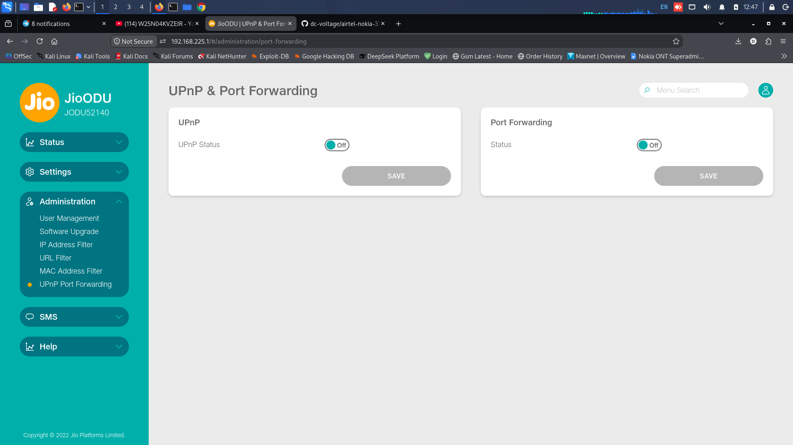
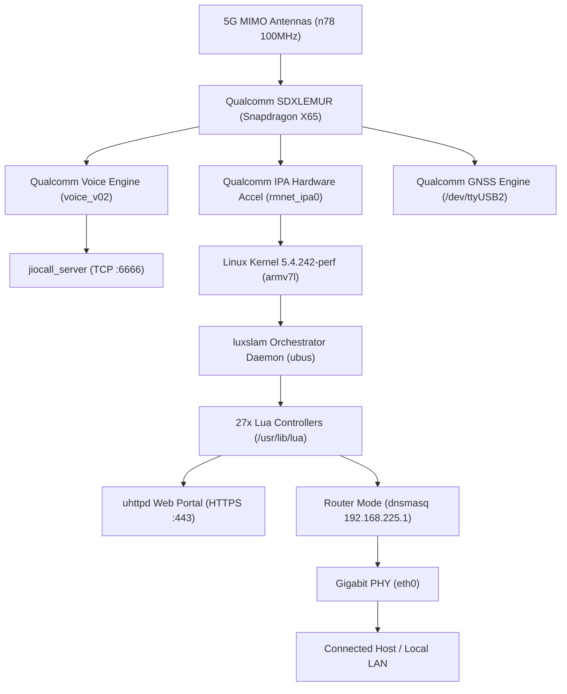

# Jio AirFiber 5G ODU (JODU52140) Reverse Engineering & Architecture

[-blue.svg)]()
[-green.svg)]()
[]()
[]()
[-purple.svg)]()
[-success.svg)]()

Comprehensive reverse-engineering documentation, system architecture analysis, configuration backups, control plane scripts, and management CLI for the **Jio AirFiber 5G Outdoor Unit (JODU52140)**.



---

## 📑 Table of Contents
- [Hardware & Serial Connection](#-hardware--serial-connection)
- [System Architecture](#-system-architecture)
- [Unlocked Web UI & Standalone Router Mode](#-unlocked-web-ui--standalone-router-mode)
- [Verified Hidden Features & Hardware Capabilities](#-verified-hidden-features--hardware-capabilities)
  - [1. Voice Calling Architecture (VoNR / VoLTE & jiocall_server)](#1-voice-calling-architecture-vonr--volte--jiocall_server)
  - [2. HPUE (High Power User Equipment) Power Class 1.5](#2-hpue-high-power-user-equipment-power-class-15)
  - [3. 5G Cell Lock & Band Lock](#3-5g-cell-lock--band-lock)
  - [4. Dual SIM & eSIM Management](#4-dual-sim--esim-management)
  - [5. Bluetooth 5.x Subsystem](#5-bluetooth-5x-subsystem)
  - [6. High-Precision GPS / GNSS Location Engine](#6-high-precision-gps--gnss-location-engine)
  - [7. SMS Gateway & Contacts Manager](#7-sms-gateway--contacts-manager)
  - [8. Built-in Enterprise VPN (OpenVPN & IPsec)](#8-built-in-enterprise-vpn-openvpn--ipsec)
  - [9. Packet Sniffing & Performance Diagnostics](#9-packet-sniffing--performance-diagnostics)
  - [10. Hardware Ethernet MAC Address Spoofing](#10-hardware-ethernet-mac-address-spoofing)
  - [11. 17-Zone Thermal Sensor Telemetry](#11-17-zone-thermal-sensor-telemetry)
  - [12. Advanced Routing, NAT & Security](#12-advanced-routing-nat--security)
- [Permanent Boot Persistence](#-permanent-boot-persistence)
- [Quick Start: Python CLI & AT Cheatsheet](#-quick-start-python-cli--at-cheatsheet)
- [Control Plane & Ubus API](#-control-plane--ubus-api)
- [License & Disclaimer](#-license--disclaimer)

---

## 🔌 Hardware & Serial Connection

The device motherboard exposes a debug UART serial header operating at **1.8V logic level**.

### Serial Parameters
* **Logic Level:** `1.8V TTL` *(Warning: 3.3V or 5.0V without level shifting will damage the SoC!)*
* **Baud Rate:** `115200`
* **Data Bits:** `8`
* **Parity:** `None`
* **Stop Bits:** `1`
* **Flow Control:** `None`

### Default Console Credentials
```text
login: root
Password: oelinux123
```

---

## 🏗️ System Architecture



### Specifications Summary
* **Device Model:** `JODU52140`
* **Product Name:** `Jio ODU`
* **ODM:** Luxshare Precision Industry Co., Ltd. (OUI: `7C:BF:77`)
* **SoC:** Qualcomm Technologies, Inc. `SDXLEMUR` (Snapdragon X65/X62)
* **Kernel:** `Linux 5.4.242-perf #1 PREEMPT armv7l`
* **Distribution:** Qualcomm QTI Linux reference distro (`LE.UM.6.2.3.r1-03100-SDX65.0`)
* **Flash Layout:** 34 MTD partitions (SBL, MIBIB, TZ, XBL, ABL, Boot, Recovery, Modem, System, Usrdata)
* **LAN IP:** `192.168.225.1/24` (Router mode) / `169.254.51.1/24` (EoGRE link-local mode)

---

## 🌐 Unlocked Web UI & Standalone Router Mode

By default, Jio ships the ODU configured strictly in **EoGRE mode** (Mode 3), serving only as an opaque Layer-2 bridge to Jio's Indoor Unit (IDU) router, with the Web UI blocked on production firmware (`REL`) returning HTTP 500 (`No operation permission`).

### How It Was Unlocked:
1. **Switched Operation Mode to Standalone Router:**
   ```bash
   ubus call luxslam lan '{"cmd":"set","class":"operation_mode","operation_mode":"1"}'
   ```
   Configures `bridge0` to `192.168.225.1/24` and starts `dnsmasq` DHCP server leasing `192.168.225.20` – `192.168.225.60`.
2. **Bypassed Production Web UI Lock:**
   Patched `/usr/lib/lua/lux-device-ctrl.lua` function `device_ctrl.can_access` to unconditionally return `true`, permitting administrative access on production `REL` firmware.
3. **Unhid Hidden Frontend Menus:**
   Patched Angular bundle `/www/main.0c5d712e49e4bd83d0fc.js` to unhide navigation menus for: Cellular APN, Port Forwarding, UPnP, Firewall, IP Filters, URL Filters, VPN, SMS, and Diagnostics.
4. **Added HTTP to HTTPS Redirector:**
   Configured `busybox httpd -h /data/www_http -p 0.0.0.0:80` to automatically redirect incoming plain HTTP traffic on port 80 to HTTPS on port 443.
5. **Permanently Neutralized Jio TR-069 ACS:**
   Disabled `cwmpc`, blackholed `acs.oss.jio.com`, `cr.acs.oss.jio.com`, and `prod.acs.jio.com` to `127.0.0.1`, and dropped outbound ports `9443` and `7547` in `iptables`.

Default Web UI Credentials:
* **URL:** `https://192.168.225.1/` (or `http://192.168.225.1/`)
* **Username:** `Admin`
* **Password:** `Admin@1234`

---

## 🔍 Verified Hidden Features & Hardware Capabilities

Every feature documented below has been **thoroughly investigated and verified directly on the JODU52140 physical hardware**:

### 1. Voice Calling Architecture (VoNR / VoLTE & jiocall_server)
* **Mechanics:** The device includes a complete voice subsystem interfacing Qualcomm's QMI Voice Service (`voice_v02` via `libqmiservices.so.1` and `libqmi_cci.so.1`).
* **Daemon:** `/usr/bin/jiocall_server` runs as a systemd service (`jio_call.service`) listening on **TCP port 6666**.
* **Modem Configuration:** A dedicated IMS APN profile (`apn='ims'`) is registered via `/sbin/lux_add_ims_apn.sh` with `AT+QCFG="ims",2,0`.
* **Capability:** Allows connected devices (e.g. JioCall Android app or custom SIP/VoIP clients) to send AT dialing commands and stream voice calls over 5G SA VoNR and 4G VoLTE directly through the ODU.

### 2. HPUE (High Power User Equipment) Power Class 1.5
* **Mechanics:** Standard 5G devices operate at Power Class 3 (+23 dBm / 200 mW). The JODU52140 modem supports **Power Class 1.5** (+29 dBm / **800 mW**) high-power RF transmission on Band n78.
* **Verification Command:**
  ```bash
  lux_atc 'AT+QPC1DOT5?'
  # Response: +QPC1DOT5: 1 (OK)
  ```
* **Benefit:** 4x higher transmission power for drastically improved uplink speeds and rock-solid connection even when far from the cell tower.

### 3. 5G Cell Lock & Band Lock
* **5G Cell Lock:** Lock the modem to a specific physical cell tower to prevent tower hopping and ensure consistent speed:
  ```bash
  lux_atc 'AT+QNWLOCK="common/5g",<pci>,<freq>,<scs>,<band>'
  ```
* **4G Cell Lock:**
  ```bash
  lux_atc 'AT+QNWLOCK="common/4g",(0-10),<freq>,<pci>'
  ```
* **5G Band Lock:** Lock the radio to Band n78 (or any supported band):
  ```bash
  lux_atc 'AT+QNWPREFCFG="nr5g_band",78'
  ```
* **Serving Cell Telemetry:** Query live connection parameters (PCI, ARFCN, RSRP, RSRQ, SINR):
  ```bash
  lux_atc 'AT+QENG="servingcell"'
  ```

### 4. Dual SIM & eSIM Management
* **Dual SIM Architecture:** The physical hardware contains both a physical Nano-SIM slot (Slot 1) and an onboard Thales eUICC eSIM (Slot 2).
* **EID:** `89033023426300000000018883054460` (retrieved via `luxcmds sys eid`).
* **Slot Switching:**
  ```bash
  lux_atc 'AT+QUIMSLOT=1'   # Switch to Physical SIM
  lux_atc 'AT+QUIMSLOT=2'   # Switch to eSIM
  ```
* **eSIM Provisioning:** Includes Thales LPA daemon (`lpad`), GSMA RSPv2 root certificate (`/data/GSMA_RSPv2-Root.pem`), SM-DP+ configuration (`/data/jio_lpa_config.ini`), and backend controller `/usr/lib/lua/lux-esim-ctrl.lua`.

### 5. Bluetooth 5.x Subsystem
* **Hardware:** Realtek UART Bluetooth controller wired to SoC UART `/dev/ttyHS0` (`7C:BF:77:7E:48:FA`).
* **Stack:** Full Linux BlueZ stack with `rtk_hciattach`, `hci0` interface, `bluetoothd`, `bluealsa` (Bluetooth Audio streaming), and `bneptest`.
* **Activation:**
  ```bash
  /data/bt/set_bt on        # Turn on Bluetooth & discovery mode
  /data/bt/set_bt off       # Turn off Bluetooth
  ```

### 6. High-Precision GPS / GNSS Location Engine
* **Hardware:** Qualcomm SDX65 GNSS multi-constellation receiver (GPS, GLONASS, Galileo, BeiDou).
* **NMEA Stream:** Live serial stream available on `/dev/ttyUSB2`.
* **Commands:**
  ```bash
  lux_atc 'AT+QGPS=1'       # Activate GPS receiver engine
  lux_atc 'AT+QGPSLOC=2'    # Query live Latitude, Longitude, Altitude & Speed
  lux_atc 'AT+QGPSEND'      # Turn off GPS
  ```

### 7. SMS Gateway & Contacts Manager
* **Backend Controller:** `/usr/lib/lua/lux-sms-ctrl.lua`.
* **Frontend Web Routes:** `#/sms`, `#/inbox`, `#/sent-messages`, `#/contacts`, `#/groups`.
* **Capabilities:** Read incoming SMS/OTPs, send single SMS, send bulk group SMS, and manage contacts stored on the device.

### 8. Built-in Enterprise VPN (OpenVPN & IPsec)
* **OpenVPN:** Full client and server capabilities managed via `/usr/lib/lua/lux-openvpn-ctrl.lua` and `/etc/config/openvpn`.
* **IPsec:** Hardware-accelerated site-to-site IPsec tunnels managed via `/usr/lib/lua/lux-ipsec-ctrl.lua` and `/etc/config/ipsec`.

### 9. Packet Sniffing & Performance Diagnostics
* **Hardware Packet Sniffer:** `/sbin/lux_capture_packets.sh` allows capturing raw network traffic on `bridge0`, `rmnet_data0`, or `eth0` directly into standard `.pcap` files for analysis in Wireshark:
  ```bash
  /sbin/lux_capture_packets.sh bridge0 50        # Capture 50MB on bridge0
  /sbin/lux_capture_packets.sh bridge0 0 stop    # Stop capture and compress pcap
  ```
* **Native iperf3:** Pre-installed `/bin/iperf3` for high-throughput LAN/WAN benchmarking:
  ```bash
  iperf3 -s -p 5201                             # Start local iperf3 server
  ```

### 10. Hardware Ethernet MAC Address Spoofing
* **Tool:** `/sbin/lux_modify_ethmac.sh`.
* **Command:**
  ```bash
  /sbin/lux_modify_ethmac.sh 7C:BF:77:AA:BB:CC
  ```
  Modifies the ODU's Ethernet physical MAC address on the fly via `AT+QETH="MAC_ADDRESS"`.

### 11. 17-Zone Thermal Sensor Telemetry
* **Command:**
  ```bash
  lux_atc 'AT+QTEMP'
  ```
* **Coverage:** Real-time temperature monitoring across 17 distinct hardware zones including 5G Power Amplifiers (PA), Snapdragon modem core, PMIC (Power Management IC), and XO crystal oscillator.

### 12. Advanced Routing, NAT & Security
* **Firewall:** Full Port Forwarding, DMZ, and Port Triggering (`/usr/lib/lua/lux-firewall-ctrl.lua`).
* **Filtering:** IP Address filtering, MAC Address filtering, and URL/Domain filtering.
* **Network Services:** UPnP IGD, IPv6 Router Advertisement (`radvd`), and Application Level Gateways (SIP ALG, FTP, RTSP, PPTP).

---

## 💾 Permanent Boot Persistence

All customizations (Web UI patches, Router mode, ACS kill, HPUE Power Class 1.5, and VoNR/VoLTE calling service) persist across power cycles via a dedicated boot script:

* **Persistence Directory:** `/usrdata/custom_unhide/` (stored on writable UBI partition `/dev/ubi0_4`).
* **Boot Script:** `/usrdata/custom_unhide/apply_unhide.sh`.
* **Systemd Service:** `/etc/systemd/system/basic.target.wants/unhide.service`.

### apply_unhide.sh Summary:
```sh
#!/bin/sh
# 1. Bind mount unlocked Lua controller
[ -f /usrdata/custom_unhide/lux-device-ctrl.lua ] && \
    mount --bind /usrdata/custom_unhide/lux-device-ctrl.lua /usr/lib/lua/lux-device-ctrl.lua

# 2. Bind mount unlocked Web UI frontend
[ -f /usrdata/custom_unhide/main.0c5d712e49e4bd83d0fc.js ] && \
    mount --bind /usrdata/custom_unhide/main.0c5d712e49e4bd83d0fc.js /www/main.0c5d712e49e4bd83d0fc.js

# 3. Permanent ACS / TR-069 Kill
uci set cwmp.general.enable='0' 2>/dev/null
killall -9 cwmpc jio_cwmp_watchdog.sh 2>/dev/null

# 4. Blackhole ACS domains
for hf in /etc/hosts /etc/data/hosts; do
    echo -e "127.0.0.1 acs.oss.jio.com\n127.0.0.1 cr.acs.oss.jio.com\n127.0.0.1 prod.acs.jio.com" >> "$hf"
done

# 5. Drop ACS outbound traffic
iptables -I OUTPUT -p tcp --dport 9443 -j DROP 2>/dev/null

# 6. Keep USB in ENG mode
uci set com_port.com_port.com_port='ENG' 2>/dev/null && uci commit com_port

# 7. Start HTTP port 80 redirector to HTTPS
busybox httpd -h /data/www_http -p 0.0.0.0:80

# 8. Ensure Voice Calling (VoNR/VoLTE jiocall_server) & IMS APN are active
systemctl enable jio_call.service 2>/dev/null
systemctl start jio_call.service 2>/dev/null
/sbin/lux_add_ims_apn.sh 2>/dev/null

# 9. Force HPUE Power Class 1.5 (+29 dBm)
lux_atc 'AT+QPC1DOT5=1' 2>/dev/null
```

---

## 🚀 Quick Start: Python CLI & AT Cheatsheet

### Python CLI (`scripts/odu_cli.py`)
```bash
./scripts/odu_cli.py info       # Query device hardware and firmware metadata
./scripts/odu_cli.py rf         # Query real-time 5G signal metrics (RSRP, SINR, Band)
./scripts/odu_cli.py network    # Inspect interfaces, bridges, and DHCP status
./scripts/odu_cli.py shell      # Direct 1.8V serial shell
```

### Essential AT Command Cheatsheet:
| Command | Action |
| :--- | :--- |
| `lux_atc 'AT+QENG="servingcell"'` | Live 5G serving cell parameters (PCI, ARFCN, RSRP, SINR) |
| `lux_atc 'AT+QPC1DOT5=1'` | Enable HPUE Power Class 1.5 (+29 dBm transmission) |
| `lux_atc 'AT+QNWLOCK="common/5g",<pci>,<freq>,<scs>,<band>'` | Lock to specific 5G cell tower |
| `lux_atc 'AT+QNWPREFCFG="nr5g_band",78'` | Lock to 5G Band n78 |
| `lux_atc 'AT+QUIMSLOT=1'` | Switch to Physical Nano-SIM |
| `lux_atc 'AT+QUIMSLOT=2'` | Switch to Embedded eSIM |
| `lux_atc 'AT+QGPS=1'` | Turn ON GPS Receiver |
| `lux_atc 'AT+QGPSLOC=2'` | Query GPS Coordinates |
| `lux_atc 'AT+QTEMP'` | Query 17-zone hardware thermal telemetry |

---

## ⚙️ Control Plane & Ubus API

The system uses `luxslam` as an IPC broker registered on `ubus`. Any script or service can invoke RPC methods:

```bash
# Query live 5G cell telemetry
ubus call luxslam 5g '{"cmd":"get","class":"serving_cell"}'

# Query hardware metadata
ubus call luxslam sys '{"cmd":"get","class":"device"}'

# Switch to router mode
ubus call luxslam lan '{"cmd":"set","class":"operation_mode","operation_mode":"1"}'
```

See [docs/UBUS_API.md](docs/UBUS_API.md) for the complete API reference.

---

## 🔒 License & Disclaimer

This project is created strictly for academic research, hardware diagnostics, and network engineering analysis on authorized user-owned equipment. All product names, logos, and brands are property of their respective owners.
