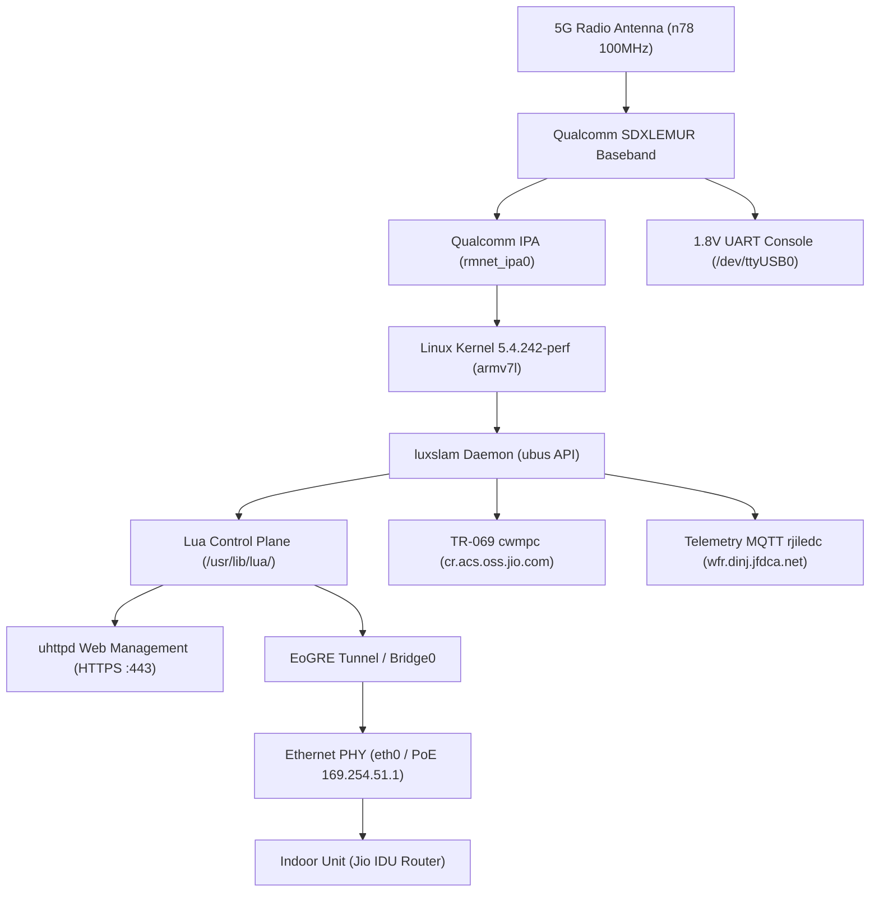
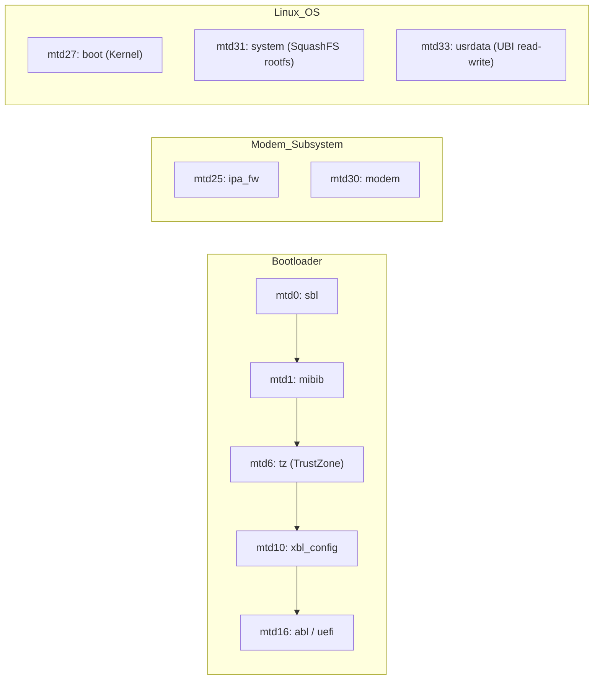
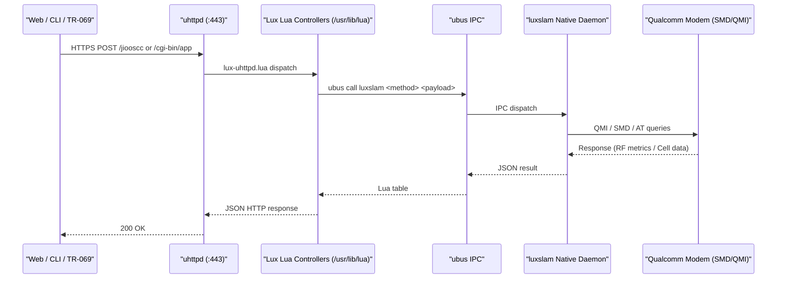
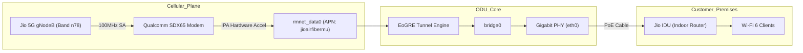

# Jio 5G Outdoor Unit (JODU52140) Architecture & Reverse Engineering Specification

## 1. Overview

The **JODU52140** is a 5G Standalone (SA) Outdoor Unit (ODU) designed for Reliance Jio's **JioAirFiber** Fixed Wireless Access (FWA) deployment. The hardware is manufactured by **Luxshare-ICT** (ODM) using the **Qualcomm SDXLEMUR** (Snapdragon X65/X62) 5G modem processor running a Qualcomm Reference Embedded Linux (QTI) platform with OpenWrt-derived userland utilities.

---

## 2. Hardware Specifications

| Component | Specification |
| :--- | :--- |
| **Model** | JODU52140 (Jio ODU) |
| **ODM / Vendor** | Luxshare Precision Industry Co., Ltd. (OUI: `7C:BF:77`) |
| **SoC / Modem** | Qualcomm Technologies, Inc. SDXLEMUR (Snapdragon X65/X62) |
| **CPU Architecture** | ARMv7 Processor rev 5 (v7l), 32-bit |
| **Flash Storage** | NAND Flash (34 MTD partitions) with UBI / SquashFS |
| **RAM** | ~256MB DDR |
| **Ethernet** | Gigabit PoE (Power over Ethernet) Interface (`eth0`) |
| **SIM Support** | Physical SIM + eSIM (GSMA Remote SIM Provisioning RSPv2) |
| **Bluetooth / BLE** | Onboard BLE for mobile alignment app (`quec_jio_bt`) |
| **Debug Interface** | 1.8V TTL UART @ 115200 8N1 |

---

## 3. Flash & Partition Layout

The NAND Flash is partitioned into 34 MTD blocks:

### Partition Highlights:
* **`mtd27 (boot)`**: Linux kernel (`5.4.242-perf`) and Flattened Device Tree (FDT).
* **`mtd30 (modem)`**: Qualcomm Hexagon DSP modem firmware image (Q6 modem).
* **`mtd31 (system)`**: Read-only SquashFS root filesystem mounted at `/dev/root`.
* **`mtd33 (usrdata)`**: UBI NAND volume providing writable persistence mounted on `/data`, `/etc`, and `/usrdata`.

---

## 4. Software Stack & Control Plane

The operating system is **QTI Linux reference nogplv3 distro** (`LE.UM.6.2.3.r1-03100-SDX65.0`). The system initializes through `systemd`, which coordinates Qualcomm radio daemons, the Luxshare orchestration engine (`luxslam`), and OpenWrt networking tools.

### Key Services & Daemons:
1. **`luxslam`**: Proprietary Luxshare daemon acting as the primary middleware bus on `ubus`. It bridges hardware commands, AT/QMI interfaces, and network configurations.
2. **`uhttpd`**: OpenWrt lightweight web server listening on port `443` (HTTPS) serving an Angular Single Page Application (SPA) with Jio styling.
3. **`cwmpc`**: TR-069 client reporting to Jio ACS (`https://acs.oss.jio.com:9443/ftacs-digest/ACS`).
4. **`rjiledc`**: Enterprise Data Collector daemon publishing telemetry metrics via MQTT over TLS to `wfr.dinj.jfdca.net:1887`.
5. **`quec_jio_bt`**: Bluetooth pairing daemon facilitating antenna alignment using technician mobile apps.
6. **`adbd`**: Android Debug Bridge daemon listening locally on `127.0.0.1:5037`.

---

## 5. Network Architecture & Data Flow

The ODU operates in three configurable network modes:

1. **EoGRE Mode (Default for JioAirFiber)**:
   * 5G cellular data is received over the `rmnet_ipa0` / `rmnet_data0` interface.
   * An Ethernet-over-GRE (EoGRE) tunnel encapsulates Layer-2 packets between the ODU and the Indoor Unit (IDU) router.
   * Ensures seamless public IP passthrough and centralized traffic routing at the IDU.

2. **Bridge Mode**:
   * Bridges the 5G data interface directly to `bridge0` / `eth0` with IP Passthrough to the connected router.

3. **Router Mode**:
   * ODU performs NAT, runs `dnsmasq` for DHCP/DNS, and assigns IPs in the `192.168.225.0/24` subnet.

