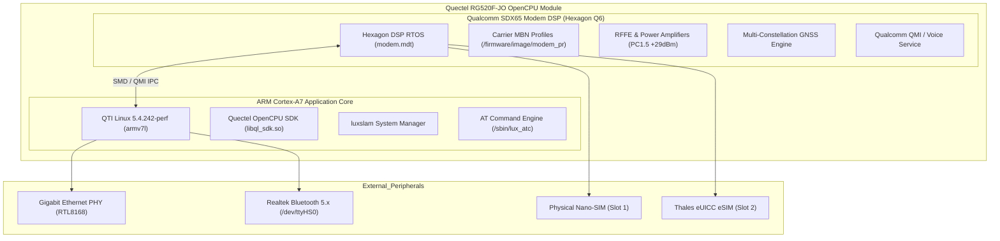

# Quectel RG520F-JO (Qualcomm SDX65) Chip Architecture & Unhide Guide

[]()
[-green.svg)]()
[]()
[-red.svg)]()

Deep reverse-engineering analysis of the **Quectel RG520F-JO** cellular modem module integrated into the **Jio AirFiber Outdoor Unit (JODU52140)**. This document reveals all hardware locks, artificial carrier restrictions enforced in stock firmware, and exact AT/system commands to unlock the chip's full capabilities.

---

## 📑 Table of Contents
- [1. Chip Overview & Architecture](#1-chip-overview--architecture)
- [2. Hardware vs. Stock Firmware Comparison](#2-hardware-vs-stock-firmware-comparison)
- [3. Full Unhide & Unlock Command Reference](#3-full-unhide--unlock-command-reference)
  - [3.1 5G Multi-Band Unlock](#31-5g-multi-band-unlock)
  - [3.2 4G LTE Band Unlock & Fallback](#32-4g-lte-band-unlock--fallback)
  - [3.3 Network Mode & RAT Acquisition Unlock](#33-network-mode--rat-acquisition-unlock)
  - [3.4 Carrier MBN Profile Switching (100+ Stored MBNs)](#34-carrier-mbn-profile-switching-100-stored-mbns)
  - [3.5 5G / 4G Physical Cell Tower Lock](#35-5g--4g-physical-cell-tower-lock)
  - [3.6 HPUE Power Class 1.5 (+29 dBm Transmission)](#36-hpue-power-class-15-29-dbm-transmission)
  - [3.7 Dual SIM & eSIM Hardware Switching](#37-dual-sim--esim-hardware-switching)
  - [3.8 Network Personalization Lock (SIM Lock Analysis)](#38-network-personalization-lock-sim-lock-analysis)
  - [3.9 High-Speed Ethernet & MAC Spoofing (AT+QETH)](#39-high-speed-ethernet--mac-spoofing-atqeth)
  - [3.10 Integrated Multi-Constellation GNSS / GPS](#310-integrated-multi-constellation-gnss--gps)
  - [3.11 PCIe Host vs. Endpoint Mode Switching](#311-pcie-host-vs-endpoint-mode-switching)
  - [3.12 OpenCPU C SDK Capabilities (`libql_sdk.so`)](#312-opencpu-c-sdk-capabilities-libql_sdkso)

---

## 1. Chip Overview & Architecture

The **RG520F-JO** is an OpenCPU variant of Quectel's 5G Sub-6GHz module based on the **Qualcomm Snapdragon X65 (SDXLEMUR)** baseband processor, customized for Luxshare-ICT and Reliance Jio.



### Module Metadata:
* **Manufacturer:** Quectel
* **Model:** `RG520F-JO`
* **Baseband SoC:** Qualcomm `SDX65` (Part Number: `SDXLEMUR`)
* **Firmware Revision:** `RG520FJOAAR05A03M4G_OCPU_LXA_03.200.03.200`
* **Compilation Tag:** `MCU_R05_852338_POSTCS5_R00286_JIO`
* **Operating Mode:** OpenCPU (Embedded Linux runs directly on the module's Cortex-A7 core)

---

## 2. Hardware vs. Stock Firmware Comparison

| Feature / Subsystem | Hardware Capability (SDX65) | Stock Jio Firmware Enforced Setting | Unlocked / Unhidden Capability |
| :--- | :--- | :--- | :--- |
| **5G Bands** | Sub-6GHz (n1, n3, n5, n8, n28, n40, n41, n48, n77, n78) | **Locked to n78 only** (`nr5g_band=78`) | **Full multi-band unlock** via `AT+QNWPREFCFG` |
| **4G LTE Bands** | LTE Cat 20 (Bands 1, 3, 5, 8, 40, 41, 42, 43, 48) | **Completely disabled** (`lte_band=0`) | **Full LTE unlock** via `AT+QNWPREFCFG` |
| **Network Mode** | AUTO (5G SA, 5G NSA, LTE, WCDMA) | **Locked to NR5G only** | **AUTO / LTE:NR5G mode enabled** |
| **Carrier MBNs** | 100+ global operator profiles stored | Locked to Jio Reliance profile | **Any carrier MBN selectable** via `AT+QMBNCFG` |
| **Cell Locking** | Physical 5G SA and 4G cell locking | Hidden from user | **Lock to PCI / ARFCN** via `AT+QNWLOCK` |
| **RF Transmit Power** | HPUE Power Class 1.5 (+29 dBm / 800 mW) | Power Class 3 (+23 dBm) / Unadvertised | **Forced +29 dBm HPUE** via `AT+QPC1DOT5=1` |
| **SIM Architecture** | Dual SIM (Slot 1 Physical + Slot 2 eSIM) | Locked to Slot 2 (eSIM) | **On-the-fly switching** via `AT+QUIMSLOT` |
| **Network Lock** | Network Personalization (`CLCK="PN"`) | `+CLCK: 1` (Jio MCC 405 locked) | Unlocked via standard NCK code |
| **Ethernet Controller** | RGMII / USXGMII up to 10Gbps | Hardcoded GbE settings | **Speed, mode & MAC spoofing** via `AT+QETH` |
| **GPS / GNSS** | Concurrent GPS, GLONASS, Galileo, BeiDou | Receiver turned off by default | **Active live NMEA** on `/dev/ttyUSB2` |
| **PCIe Interface** | Root Complex (Host) or Endpoint (Client) | Root Complex only | **Switchable to PCIe M.2 client** mode |

---

## 3. Full Unhide & Unlock Command Reference

All commands below are executed via the native AT engine:
```bash
adb shell "lux_atc '<AT_COMMAND>'"
# Or via Python CLI:
./scripts/odu_cli.py --adb cmd "lux_atc '<AT_COMMAND>'"
```

---

### 3.1 5G Multi-Band Unlock
In stock firmware, Jio restricts the 5G radio strictly to Band n78. The SDX65 hardware supports all major Sub-6GHz bands.

* **Query Current 5G Bands:**
  ```bash
  lux_atc 'AT+QNWPREFCFG="nr5g_band"'
  # Stock response: +QNWPREFCFG: "nr5g_band",78
  ```
* **Unlock All Supported 5G Bands (n1, n3, n5, n8, n28, n40, n41, n77, n78):**
  ```bash
  lux_atc 'AT+QNWPREFCFG="nr5g_band",1:3:5:8:28:40:41:77:78'
  # Response: OK
  ```

---

### 3.2 4G LTE Band Unlock & Fallback
In stock firmware, Jio sets `lte_band=0`, disabling the 4G LTE baseband entirely to force 5G SA.

* **Query Current LTE Bands:**
  ```bash
  lux_atc 'AT+QNWPREFCFG="lte_band"'
  # Stock response: +QNWPREFCFG: "lte_band",0 (Disabled)
  ```
* **Unlock LTE Bands (B1, B3, B5, B8, B40, B41):**
  ```bash
  lux_atc 'AT+QNWPREFCFG="lte_band",1:3:5:8:40:41'
  # Response: OK
  ```

---

### 3.3 Network Mode & RAT Acquisition Unlock
* **Query Current Mode:**
  ```bash
  lux_atc 'AT+QNWPREFCFG="mode_pref"'
  # Stock response: +QNWPREFCFG: "mode_pref",NR5G
  ```
* **Enable Automatic 5G/4G Mode Preference:**
  ```bash
  lux_atc 'AT+QNWPREFCFG="mode_pref",AUTO'
  # Response: OK
  ```
* **Enable Dual 4G/5G Mode (LTE + NR5G):**
  ```bash
  lux_atc 'AT+QNWPREFCFG="mode_pref",LTE:NR5G'
  # Response: OK
  ```

---

### 3.4 Carrier MBN Profile Switching (100+ Stored MBNs)
The module's NAND storage contains **hundreds of carrier MBN profiles** located in `/firmware/image/modem_pr/mcfg/configs/mcfg_sw/generic/`:
* Reliance Jio (`generic/APAC/Reliance/Commercial/mcfg_sw.mbn`)
* Generic ROW 3GPP (`generic/Quectel/ROW/Generic_3GPP_PTCRB_GCF/mcfg_sw.mbn`)
* Telstra, Optus, Vodafone, AT&T, T-Mobile, Verizon, Orange, Deutsche Telekom, etc.

* **List Loaded MBN Profiles:**
  ```bash
  lux_atc 'AT+QMBNCFG="List"'
  ```
* **Enable Auto-Selection Based on Inserted SIM:**
  ```bash
  lux_atc 'AT+QMBNCFG="AutoSel",1'
  ```
* **Select a Specific MBN Profile:**
  ```bash
  lux_atc 'AT+QMBNCFG="Select","<MBN_NAME>",0'
  ```

---

### 3.5 5G / 4G Physical Cell Tower Lock
Cell locking allows locking the modem to a specific tower's Physical Cell ID (PCI) to stop tower hopping and stabilize speeds.

* **Query Serving Cell Parameters (PCI, ARFCN, RSRP, SINR):**
  ```bash
  lux_atc 'AT+QENG="servingcell"'
  # Example output:
  # +QENG: "servingcell","LIMSRV","NR5G-SA","TDD",405,862,103978002,408,1F,634080,78,12,-106,-11,9,1,13
  # PCI = 408, ARFCN = 634080, Band = 78, SCS = 12
  ```
* **Lock to 5G Cell:**
  ```bash
  lux_atc 'AT+QNWLOCK="common/5g",<PCI>,<FREQ_ARFCN>,<SCS>,<BAND>'
  # Example: lux_atc 'AT+QNWLOCK="common/5g",408,634080,12,78'
  ```
* **Clear 5G Cell Lock:**
  ```bash
  lux_atc 'AT+QNWLOCK="common/5g",0'
  ```
* **Lock to 4G Cell:**
  ```bash
  lux_atc 'AT+QNWLOCK="common/4g",1,<EARFCN>,<PCI>'
  ```

---

### 3.6 HPUE Power Class 1.5 (+29 dBm Transmission)
* **Query HPUE Status:**
  ```bash
  lux_atc 'AT+QPC1DOT5?'
  # Response: +QPC1DOT5: 1 (Enabled)
  ```
* **Enable HPUE Power Class 1.5 (+29 dBm / 800 mW):**
  ```bash
  lux_atc 'AT+QPC1DOT5=1'
  # Response: OK
  ```

---

### 3.7 Dual SIM & eSIM Hardware Switching
The hardware contains both an internal nano-SIM slot and an embedded Thales eUICC eSIM.

* **Query Active SIM Slot:**
  ```bash
  lux_atc 'AT+QUIMSLOT?'
  # Response: +QUIMSLOT: 2 (eSIM)
  ```
* **Switch to Physical Nano-SIM (Slot 1):**
  ```bash
  lux_atc 'AT+QUIMSLOT=1'
  ```
* **Switch to Embedded eSIM (Slot 2):**
  ```bash
  lux_atc 'AT+QUIMSLOT=2'
  ```
* **Query eSIM EID:**
  ```bash
  luxcmds sys eid
  # Output: SUCCESS:89033023426300000000018883054460
  ```

---

### 3.8 Network Personalization Lock (SIM Lock Analysis)
* **Check Lock States:**
  ```bash
  lux_atc 'AT+CLCK="PN",2'   # Network Personalization (1 = Locked to Jio)
  lux_atc 'AT+CLCK="PU",2'   # Network Subset Personalization (0 = Unlocked)
  lux_atc 'AT+CLCK="PP",2'   # Service Provider Personalization (0 = Unlocked)
  lux_atc 'AT+CLCK="PC",2'   # Corporate Personalization (0 = Unlocked)
  ```
* **Unlock Network Personalization:**
  ```bash
  lux_atc 'AT+CLCK="PN",0,"<8_DIGIT_NCK>"'
  ```

---

### 3.9 High-Speed Ethernet & MAC Spoofing (AT+QETH)
The modem interacts with the onboard Realtek RTL8168 Gigabit Ethernet controller via Qualcomm's `QETH` driver:

* **Query QETH Capabilities:**
  ```bash
  lux_atc 'AT+QETH=?'
  # Supported: speed (0M-10000M), rgmii, ipptmac, mac_address, eth_driver, eth_at, qps_port
  ```
* **Modify Hardware Ethernet MAC Address:**
  ```bash
  lux_atc 'AT+QETH="MAC_ADDRESS",7C:BF:77:XX:XX:XX'
  ```
* **Set Ethernet Link Speed / Duplex:**
  ```bash
  lux_atc 'AT+QETH="speed","1000M"'
  ```

---

### 3.10 Integrated Multi-Constellation GNSS / GPS
* **Turn ON GPS Receiver Engine:**
  ```bash
  lux_atc 'AT+QGPS=1'
  ```
* **Query High-Precision Coordinates (Outdoor):**
  ```bash
  lux_atc 'AT+QGPSLOC=2'
  # Returns: +QGPSLOC: <UTC>,<Latitude>,<Longitude>,<HDOP>,<Altitude>,<Fix>,<COG>,<Spkm>,<Spkn>,<Date>,<nsat>
  ```
* **Stream Raw NMEA Sentences ($GNGGA, $GNRMC):**
  ```bash
  cat /dev/ttyUSB2
  ```
* **Turn OFF GPS:**
  ```bash
  lux_atc 'AT+QGPSEND'
  ```

---

### 3.11 PCIe Host vs. Endpoint Mode Switching
* **Query PCIe Mode:**
  ```bash
  lux_atc 'AT+QCFG="pcie/mode"'
  # +QCFG: "pcie/mode",1 (Root Complex / Host Mode)
  ```
* **Switch to Endpoint Mode (For M.2 Carrier Boards):**
  ```bash
  lux_atc 'AT+QCFG="pcie/mode",0'
  ```

---

### 3.12 OpenCPU C SDK Capabilities (`libql_sdk.so`)
The module includes Quectel's complete OpenCPU C API library (`/usr/lib/libql_sdk.so`), allowing compiled native userland C/C++ applications to directly control the baseband:

* `ql_atc_send` / `ql_atc_send_async`: Asynchronous AT execution without serial latency.
* `ql_data_call_create` / `ql_data_call_delete`: High-performance data routing.
* `ql_can_send_speed` / `ql_can_send_gear`: Integrated Controller Area Network (CAN) bus protocols.
* `ql_adc_show`: Hardware Analog-to-Digital Converter voltage telemetry.
